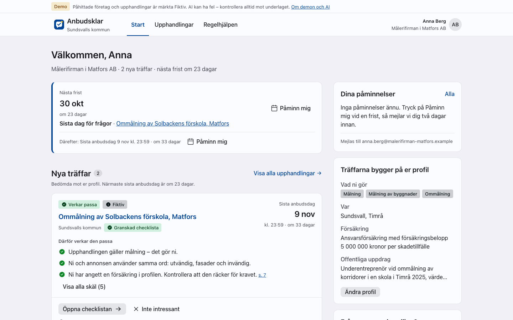
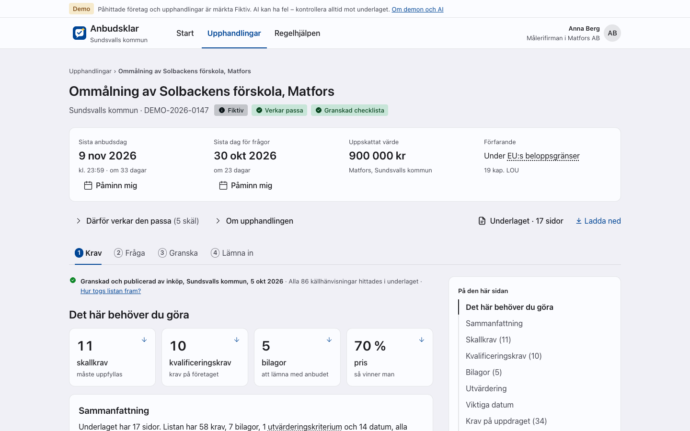

<div align="center">

<picture>
  <source media="(prefers-color-scheme: dark)" srcset="docs/assets/logo-dark.svg">
  
</picture>

# Anbudshjälpen

**AI-coach som hjälper småföretag att hitta, förstå och svara på kommunens upphandlingar**

[](https://www.gnu.org/licenses/agpl-3.0)
[](#vad-är-anbudshjälpen)
[](docs/poc.md)
[](#bidra)

[Kom igång](#kom-igång) • [Funktioner](#funktioner) • [Dokumentation](#dokumentation) • [Bidra](#bidra)

<p lang="en"><em>Anbudshjälpen is an open-source AI coach that helps small businesses take part in public procurement. The documentation is in Swedish.</em></p>

</div>

---

## Vad är Anbudshjälpen?

Anbudshjälpen är en AI-coach som hjälper småföretag att hitta, förstå och svara på kommunens upphandlingar. Den byggs av
Sundsvalls kommun, tillsammans med kommunens näringslivsenhet och inköp.

Företagaren beskriver sitt företag en gång. Anbudshjälpen bevakar kommunens upphandlingar och gör om
förfrågningsunderlag till checklistor med sidhänvisningar. Tjänsten svarar på frågor om underlaget och granskar
anbudsutkastet mot kraven före inlämning. Själva anbudet lämnas som i dag i e-Avrop.

> **Status: PoC.** Repot innehåller en PoC (proof of concept) som fortfarande byggs. Alla företag, personer och
> underlag i demodatan är påhittade och märkta. Annonserna från TED och lagtexten är riktiga offentliga data.

### Så används AI

Som standard kör Anbudshjälpen en regelbaserad motor utan AI-modell (`AI_ENGINE=heuristic`). Den plockar ut krav och
datum med fasta regler och fungerar utan nätverk. En riktig AI-modell kommer från en Eneo-instans (`AI_ENGINE=eneo`,
efter `anbudsklar eneo provision`, se [Eneo-integration](docs/eneo-integration.md)) eller från en OpenAI-kompatibel
tjänst (`AI_ENGINE=openai`).

Oavsett motor har varje påstående som visas för användaren en källa, till exempel en sida i underlaget eller en
paragraf i LOU. Appen kontrollerar själv varje citat mot texten, och en modell kan aldrig markera sitt eget citat som
kontrollerat. Webbappen säger vilken motor som tog fram innehållet.

### Varför Anbudshjälpen?

- **Källa till varje påstående:** krav, svar och skäl hänvisar till sin källa, till exempel sidan i underlaget eller
  paragrafen i lagen.
- **Granskat av inköp:** en checklista visas för företagen först när inköp har granskat och publicerat den.
- **Likabehandling:** coachen ger aldrig en leverantör råd som går utöver underlaget. Det som underlaget inte svarar
  på hänvisas till frågefunktionen i e-Avrop, så att alla får samma svar.
- **Dataskydd i designen:** anbudsutkast granskas i minnet och sparas aldrig, och MCP-servern lämnar bara ut
  offentliga data.
- **Byggd för Eneo:** med Eneo som motor är varje AI-uppgift en assistent i Eneo, den öppna AI-plattformen för
  offentlig sektor. Uppgifterna har samma form som ett steg i Eneo Flows.
- **Öppen källkod:** AGPL-3.0, samma licens som Eneo.

---

## Funktioner

- **Start för företaget:** nästa frist överst med "Påminn mig", och träffarna som kort med skälen till bedömningen.
- **Upphandlingar:** sök, filtrera på källa och köpare och, som inloggad företagare, välj "Visa bara det som passar
  er".
- **Upphandlingens fyra steg:**
  - **1 Krav:** en checklista där varje rad länkar till citatet i underlaget.
  - **2 Fråga:** svar med citat ur underlaget.
  - **3 Granska:** jämför ett anbudsutkast (PDF, Word eller text, högst 20 MB) med kraven och sparar det aldrig.
  - **4 Lämna in:** en lista att bocka av och en länk till e-Avrop.
- **Mejl:** påminnelser före sista dag för frågor och sista anbudsdag, och besked om nya träffar.
- **Företagsprofil:** företaget beskriver sig med egna ord och får förslag på CPV-koder med skäl.
- **Regelhjälpen:** svar på allmänna frågor om upphandling, med paragraferna i lagen om offentlig upphandling (LOU)
  och avsnitten i kommunens inköpsstrategi, tydligt märkta som lag respektive kommunens styrdokument.
- **Granskning för inköp:** ett granskningsbord där checklistan står bredvid källan i underlaget, med automatiska
  kontroller, och där inköparen godkänner och publicerar.
- **Företagens frågor och Drift:** inköp ser företagens frågor sammanställda utan namn, och på sidan Drift ser
  inköparen de schemalagda jobben och kan köra dem.
- **Utseende och tillgänglighet:** ljust, mörkt eller automatiskt läge. Webbappen är byggd för WCAG 2.2 AA och testas
  med Playwright och axe.
- **MCP-server för Eneo:** en MCP-server som bara läser, med tretton verktyg som låter Eneos assistenter söka i
  upphandlingar, underlag, LOU och kommunens styrdokument för inköp.

---

## Kom igång

### Prova demon

Du behöver Docker med Compose. Från repots rot:

```bash
cp .env.example .env
make up                                    # bygger och startar hela stacken
docker compose exec app anbudsklar seed    # påhittade demodata och CPV-koder
```

Öppna http://127.0.0.1:3501, välj Logga in och sedan "Fortsätt som Anna" (företagaren) eller "Fortsätt som Lars"
(inköparen). Mejlen hamnar i Mailpit på http://127.0.0.1:8025. Worker hämtar lagtexten för Regelhjälpen från
Riksdagen första gången den startar, vilket kräver internet.

> **Bra att veta:** stacken är gjord för demo och utveckling. Den använder den regelbaserade motorn tills du byter
> `AI_ENGINE`, skickar alla mejl till Mailpit och har ingen riktig inloggning
> ([beslut 0007](docs/decisions/0007-poc-login-persona-picker.md)). Testmiljön i Dokploy beskrivs i
> [Dokploy](deploy/dokploy/README.md).

### Utveckla

Du behöver också [uv](https://docs.astral.sh/uv/) 0.9 eller senare och Node 22.22.2 eller senare i 22-serien, eller
24.15 eller senare. Från repots rot:

```bash
make setup                 # installera beroenden
cp .env.example .env
make services              # Postgres och Mailpit
make migrate
make seed                  # påhittade demodata och CPV-koder
make dev-api               # terminal 1: API:t på port 8500
make dev-web               # terminal 2: webbappen på http://127.0.0.1:3502
```

`make ingest-lou` hämtar lagtexten för Regelhjälpen (kräver internet). Kontrollerna körs med `make check` och
tillgänglighetstestet med `make gate`. Hur du kopplar in Eneo eller en OpenAI-kompatibel tjänst, kör hela stacken i
containrar och kör testerna står i [Utveckling](docs/development.md).

---

## Så ser det ut

<div align="center">

<p><em>Start för företaget: nästa frist och träffarna som verkar passa (påhittade demodata)</em></p>
</div>

<div align="center">

<p><em>En upphandling, steg 1 Krav: fristerna och checklistan som inköp har granskat (påhittade demodata)</em></p>
</div>

---

## Arkitektur

En image kör både app och worker, med Postgres och Mailpit bredvid:

- **Backend:** FastAPI med SQLAlchemy 2 och Alembic, på Python 3.12.
- **Databas:** PostgreSQL 16 med fulltextsökning på svenska och trigram
  ([beslut 0003](docs/decisions/0003-postgres.md), [0005](docs/decisions/0005-domain-search-in-postgres.md)).
- **Webbapp:** Vite, React och TypeScript med Astryx och Eneo-temat, serverad av FastAPI
  ([beslut 0002](docs/decisions/0002-react-and-astryx.md), [0006](docs/decisions/0006-vite-spa-served-by-fastapi.md)).
- **Worker:** schemalagda jobb som hämtar annonser och lagtext, tolkar underlag, matchar företag och skickar mejl.
- **MCP-server:** på `/mcp`, för Eneos assistenter. Den läser bara offentliga data
  ([beslut 0004](docs/decisions/0004-eneo-api-and-own-mcp-server.md)).
- **AI-motor:** Eneo via API, med en OpenAI-kompatibel tjänst och den regelbaserade motorn som reserv. De styrda
  uppgifterna flyttar till Eneo Flows när Flows är klart ([beslut 0004](docs/decisions/0004-eneo-api-and-own-mcp-server.md)).
- **Inloggning:** val av demoperson, bara i PoC:n ([beslut 0007](docs/decisions/0007-poc-login-persona-picker.md)).
- **Drift:** Docker Compose lokalt och i Dokploy.

Hur delarna hänger ihop, och målbilden för produktion, står i [Arkitektur](docs/architecture.md).

---

## Dokumentation

| Jag vill … | Läs |
|---|---|
| förstå bakgrunden och vad underlaget föreslår | [Bakgrund](docs/background.md) |
| se vad PoC:n ska visa | [PoC](docs/poc.md) |
| se hur lösningen är uppbyggd | [Arkitektur](docs/architecture.md) |
| förstå AI-uppgifterna och citatkontrollen | [AI-uppgifterna](docs/ai-tasks.md) |
| veta hur tolkningen mäts mot facit | [Kvalitetstest](docs/quality-test.md) |
| se hur gränssnittet är uppbyggt och vilka ord det använder | [Design](docs/design.md) |
| förstå riktningen som gränssnittet byggdes efter | [Målbild för gränssnittet](docs/direction.md) |
| koppla appen till Eneo | [Eneo-integration](docs/eneo-integration.md) |
| veta varifrån datan kommer | [Datakällor](docs/data-sources.md) |
| köra appen och testerna | [Utveckling](docs/development.md) |
| driftsätta eller felsöka | [Drift](docs/operations.md) och [Dokploy](deploy/dokploy/README.md) |
| veta vad Eneo redan kan och vad som är på väg | [Eneos byggstenar](docs/eneo-building-blocks.md) |
| se vad som är beslutat | [Beslut](docs/decisions/README.md) |
| se vad som återstår att avgöra | [Öppna frågor](docs/open-questions.md) |
| förstå en term | [Ordlista](docs/glossary.md) |
| bidra med kod eller dokumentation | [Bidra](docs/CONTRIBUTING.md) |
| rapportera en säkerhetsbrist | [Säkerhet](docs/SECURITY.md) |

Hela indexet, med status för varje sida, finns i [docs/README.md](docs/README.md). Arbetar du som AI-agent, börja med
[`AGENTS.md`](AGENTS.md) (engelska).

---

## Bidra

Bidrag är välkomna från kommuner, organisationer och utvecklare.

1. Börja med ett ärende i [GitHub Issues](https://github.com/Sundsvallskommun/anbudshjalpen/issues) och beskriv vad du
   vill ändra och varför.
2. Gör ändringen i en egen gren. Ändrar du något som dokumentationen beskriver, ändra sidan i samma commit.
3. Kör `make check`, och `make gate` om du har ändrat gränssnittet.
4. Öppna en pull request som hänvisar till ärendet.

Läs [Bidra](docs/CONTRIBUTING.md) innan du börjar. En säkerhetsbrist rapporterar du enligt
[Säkerhet](docs/SECURITY.md), aldrig i ett öppet ärende.

---

## Samverkan och styrning

Anbudshjälpen utvecklas av Sundsvalls kommun. Arbetet görs tillsammans med näringslivsenheten och inköp i kommunen.
Arkitekturbesluten står i [Beslut](docs/decisions/README.md), och det som återstår att avgöra, med vem som behöver
svara, står i [Öppna frågor](docs/open-questions.md).

### Delta

- **Frågor, idéer och fel:** [GitHub Issues](https://github.com/Sundsvallskommun/anbudshjalpen/issues)
- **Kod och dokumentation:** pull requests enligt [Bidra](docs/CONTRIBUTING.md)
- **Säkerhetsbrister:** mejla `security@sundsvall.se` enligt [Säkerhet](docs/SECURITY.md)

---

## Tack

- **Utvecklas av:** Sundsvalls kommun, tillsammans med näringslivsenheten och inköp.
- **Bygger på:** [Eneo](https://github.com/eneo-ai/eneo), den öppna AI-plattformen för offentlig sektor som Sundsvalls
  kommun och Ånge kommun tog fram.
- **Gränssnitt:** [Astryx](https://github.com/facebook/astryx) med Eneo-temat.
- **Öppna data:**
  - annonser från [TED](https://ted.europa.eu/), Europeiska unionens publikationsbyrå
  - lagen (2016:1145) om offentlig upphandling från [Riksdagens öppna data](https://data.riksdagen.se/)
  - kommunens inköpsstrategi, fastställd av kommunfullmäktige 2023-09-25, från sundsvall.se
  - CPV-koderna: CPV 2008, Europeiska unionens publikationsbyrå (ted.europa.eu)

---

## Licens

```
Anbudshjälpen – AI-coach för småföretag i kommunens upphandlingar
Copyright (C) 2026 Sundsvalls kommun

Licensierad under GNU Affero General Public License v3.0
```

Hela licenstexten finns i [LICENSE](LICENSE), och skälen till valet i
[beslut 0008](docs/decisions/0008-license-agpl-3.md). Filer från andra behåller sina egna villkor, till exempel
CPV-listan ([data/cpv/README.md](data/cpv/README.md)) och typsnittet i
[data/fixtures/fonts/LICENSE](data/fixtures/fonts/LICENSE).

---

<div align="center">

**Byggd av Sundsvalls kommun**

*Så att fler småföretag kan svara på kommunens upphandlingar*

[GitHub Issues](https://github.com/Sundsvallskommun/anbudshjalpen/issues) • [Bidra](docs/CONTRIBUTING.md) • [Säkerhet](docs/SECURITY.md) • [Licens](LICENSE)

</div>
